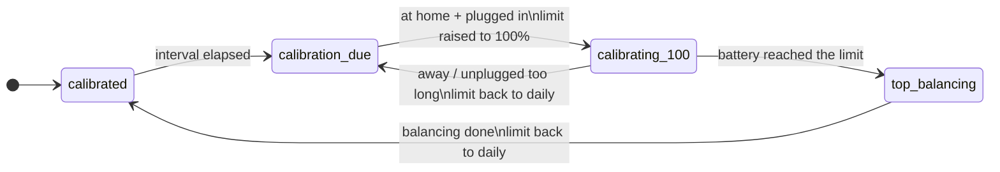

# EV LFP Battery Coach for Home Assistant

[](https://hacs.xyz)
[](https://github.com/ugidj/ha-ev-lfp-coach/releases)
[](https://github.com/ugidj/ha-ev-lfp-coach/actions/workflows/tests.yml)
[](LICENSE)

**Automatic, safe calibration of LFP (lithium iron phosphate) electric-vehicle batteries.**
Keep the daily charge limit low, and let Home Assistant take the car to 100% every couple of
weeks, wait for the BMS to balance the cells, and put the limit back. No YAML, no helpers.

🇮🇹 [Leggi in italiano](README.it.md)

> [!WARNING]
> **Alpha (0.x).** Developed against a **Tesla Model 3** (Tesla integration, whose
> charging status values are `charging`, `complete`, `stopped`, `disconnected`, `no_power`,
> `starting`) and tested with an automated suite that simulates the vehicle. A full real-world charge cycle is still being confirmed. Other brands (BYD, MG,
> Volvo, ...) may report the end of a charge differently, and the "finished" detection may need
> tuning — see [Compatibility](#compatibility). Please report what your car does.

> Compatible in principle with any EV (or smart charger) whose Home Assistant integration exposes a
> **battery level**, a **charge limit you can set** and a **charging status**: Tesla Model 3/Y RWD
> (Teslemetry, Tesla Fleet), BYD, MG4, Volvo EX30, Hyundai/Kia, VW group, ... See
> [Compatibility](#compatibility) for what has actually been verified.

---

## Why

LFP packs have a very flat voltage curve, so the BMS cannot estimate the state of charge reliably
unless it periodically sees a full charge and balances the cells. Manufacturers recommend charging
to 100% every one or two weeks. For daily use, however, a limit around 70–80% is gentler on the
battery. Doing the switch by hand is easy to forget, and automating it naively hides a trap:

> If an automation lowers the limit to 75% *the moment* the battery touches 100%, the car stops
> charging and the BMS never gets its low-power **top balancing** phase (typically 15–30 min).

EV LFP Battery Coach is built around that trap.

## How it works



1. **Due?** A calibration becomes due at local midnight of the N-th day after the previous one
   (14 by default). Counting calendar days instead of 24-hour periods keeps evening charging
   habits from pushing the schedule one day further every cycle.
2. **Start.** When the car is **home and plugged in** and a calibration is due, the coach raises
   the charge limit to the calibration limit and notifies you.
3. **Top balancing.** When the battery reaches the target, the limit is left alone. The phase ends
   only when **one** of these happens:
   - the charging status reports "finished" (`complete`, `stopped`, ... — configurable) **and**
     the *minimum time at the top* (30 min by default) has passed. This is the default and what
     the Tesla integration reports when the car stops charging;
   - optionally, if your wall box is connected to Home Assistant: the car has stopped **drawing
     current** (power at or below ~50 W for 3 minutes, after the minimum time). This is more
     precise than the status, which is then ignored;
   - the cable is unplugged;
   - the *safety timeout* expires (45 min by default), whatever the car reports.
4. **Finish.** After a short buffer the daily limit is restored, the calibration is recorded and
   you are notified.

### Built to be safe

| Situation | What the coach does |
| --- | --- |
| A sensor is `unavailable` / `unknown` / not a number | Takes **no decision**. It is never read as 0 %, "unplugged" or "away". |
| Car goes offline while balancing | Keeps waiting; only an explicit "unplugged", the end of power draw (or finished status) or the timeout end the phase. |
| Charging power sensor goes `unavailable` | Never read as "0 W": the phase simply keeps waiting. |
| Home Assistant restarts or the entry reloads mid-cycle | The phase, its start time and flags are persisted; timers are rebuilt from them. The limit can't be stranded at 100%. |
| Vehicle integration isn't loaded yet at boot | No decisions until Home Assistant has fully started. |
| Burst of state updates from the car | Debounced and serialized; one command, one notification. |
| Cloud lags behind the command | The command is not repeated until a 5-minute grace has passed. |
| The car doesn't answer (asleep, rate-limited) | Retries every 5 minutes, raises a **Repairs** issue after 3 failures, recovers on its own. |
| You unplug / leave during calibration | After 12 h (configurable) the daily limit is restored and the calibration retried next time. |
| You charge to 100% yourself | Counts as a calibration; the limit is restored afterwards (can be turned off). |

## Installation

### HACS (recommended)

1. HACS → ⋮ → **Custom repositories** → add `https://github.com/ugidj/ha-ev-lfp-coach`,
   category **Integration**.
2. Download **EV LFP Battery Coach** and restart Home Assistant.
3. **Settings → Devices & services → Add integration → EV LFP Battery Coach**.

### Manual

Copy `custom_components/ev_lfp_coach` into your `<config>/custom_components/` and restart.

Requires Home Assistant **2026.1.0** or newer (developed and tested against 2026.10).

## Configuration

Everything is done from the UI. Add one entry per vehicle.

**Vehicle**

| Field | Needed | Notes |
| --- | --- | --- |
| Battery level | yes | State of charge sensor in %. |
| Charge limit | yes | A `number` entity the coach can set. One coach per charge limit entity. |
| Charging status | yes | Sensor (or binary sensor) with the charging state. |

Everything below sits in a collapsed **Optional settings** section and can stay empty:

| Field | Notes |
| --- | --- |
| Cable connected | Binary sensor, `on` when plugged. Without it the state is derived from the charging status (`disconnected` = unplugged). |
| Calibrate only when at home | **Off by default:** the calibration also happens if you charge away from home. Turn on to restrict it to your home; then choose the location below. |
| Location / Home zone | Device tracker (or person) and, if needed, the zone. Used only when *only at home* is on. |
| Charging power | Power sensor of the wall box (W or kW). Only useful if your wall box is **connected to Home Assistant**; then top balancing ends when the car stops drawing current and the charging status is ignored for that decision. Leave empty otherwise. |

**Parameters** (changeable any time with **Configure**, daily limit / calibration limit / interval
also from dashboard sliders)

| Option | Default | Meaning |
| --- | --- | --- |
| Daily charge limit | 75 % | Limit used between calibrations. |
| Calibration charge limit | 100 % | Target of the calibration charge (90–100). |
| Calibration interval | 14 days | Days between calibrations. |
| Minimum time at the top | 30 min | The limit is never lowered earlier because of a status (unplugging still ends it). |
| Top balancing timeout | 45 min | Safety net. |
| Delay before restoring | 30 s | Extra wait after the end of balancing is detected. |
| Power considered "not charging" | 50 W | At or below this the car counts as not drawing current (needs a charging power sensor). |
| Idle time before balancing ends | 3 min | The power must stay idle this long (needs a charging power sensor). |
| Statuses meaning "finished" | complete, stopped, disconnected, no_power | Add your car's own values. Ignored while a charging power sensor is set. |
| Give up after | 12 h | Unplugged/away while calibrating. 0 = never. |
| Restore after my own 100 % charge | on | Also put the daily limit back after a full charge you started. |
| Notifications | on | Target: a notify entity, a `notify.*` service, or empty for persistent notifications. |

Changed car integration or renamed entities? Use **Reconfigure** on the entry: the calibration
history is kept.

## Entities

For a vehicle called *Model 3*:

| Entity | Description |
| --- | --- |
| `sensor.model_3_calibration_state` | `calibrated`, `calibration_due`, `calibrating_100`, `top_balancing`. Attributes: `history` (last 10 calibrations), `phase_started`, limits. |
| `sensor.model_3_days_since_calibration` | Days since the last full charge (unknown if none recorded). |
| `sensor.model_3_last_calibration` / `..._next_calibration` | Timestamps (diagnostic). |
| `binary_sensor.model_3_calibration_due` | On when a calibration is due. |
| `binary_sensor.model_3_calibration_in_progress` | On while calibrating or balancing. |
| `button.model_3_calibrate_on_next_charge` | Force a calibration at the next charge. |
| `button.model_3_cancel_calibration` | Abort, restore the daily limit, don't ask again for 24 h. |
| `button.model_3_mark_calibrated_now` | Record a full charge (diagnostic/config). |
| `number.model_3_daily_charge_limit`, `..._calibration_charge_limit`, `..._calibration_interval` | Tune from the dashboard. |
| `switch.model_3_automatic_management` | Pause the coach (restores the daily limit if a cycle was running). |

Entity IDs are generated from the entity names in the language of your Home Assistant at the time
the entry is created.

## Services

All three target the **calibration state** sensor.

```yaml
action: ev_lfp_coach.start_calibration     # same as the button
target:
  entity_id: sensor.model_3_calibration_state
---
action: ev_lfp_coach.cancel_calibration
target:
  entity_id: sensor.model_3_calibration_state
---
action: ev_lfp_coach.mark_calibrated       # e.g. you did a full charge last Sunday
target:
  entity_id: sensor.model_3_calibration_state
data:
  timestamp: "2026-10-18 21:30:00"
```

## Events

Fired on the bus, handy for your own automations. All carry `entry_id` and `vehicle`.

| Event | Extra data |
| --- | --- |
| `ev_lfp_coach_calibration_started` | `limit` |
| `ev_lfp_coach_balancing_started` | `limit` |
| `ev_lfp_coach_calibration_completed` | `reason` (`status`, `timeout`, `unplugged`, `manual`), `minutes_at_top` |
| `ev_lfp_coach_calibration_aborted` | `reason` (`unplugged`, `away`, `manual`) |

```yaml
automation:
  - alias: Tell the family the car is balanced
    triggers:
      - trigger: event
        event_type: ev_lfp_coach_calibration_completed
    actions:
      - action: notify.family
        data:
          message: "{{ trigger.event.data.vehicle }} calibrated ({{ trigger.event.data.minutes_at_top }} min at the top)"
```

## Dashboard example

```yaml
type: entities
title: Model 3 battery
entities:
  - sensor.model_3_calibration_state
  - sensor.model_3_days_since_calibration
  - sensor.model_3_next_calibration
  - number.model_3_daily_charge_limit
  - number.model_3_calibration_interval
  - switch.model_3_automatic_management
  - button.model_3_calibrate_on_next_charge
  - button.model_3_cancel_calibration
```

## Compatibility

The coach only talks to *entities*, so it works with whatever integration provides them. The
default "finished" statuses (`complete`, `stopped`, `disconnected`, `no_power`) match the
**Tesla** integrations (Teslemetry, Tesla Fleet). For other brands, look at the values your
charging status sensor takes and add the ones meaning "stopped charging" in the options.

The behaviour is covered by an automated test suite that simulates the vehicle (restarts,
unavailable sensors, failing commands, ...). **Real-world reports are very welcome** — please use
the *Vehicle compatibility report* issue template; verified cars will be listed here.

Note that how an LFP BMS balances and what a car reports at 100% varies by manufacturer. Check your
manufacturer's recommendation for calibration frequency; this integration only automates the
procedure you configure and carries no warranty (see the license).

## Troubleshooting

- **Nothing happens.** Open the *Calibration state* sensor: `calibrated` means not due yet.
  Calibration starts only with the car home **and** plugged in, and only when the sensors report
  real values. Download the diagnostics (⋮ on the integration) — the `snapshot` shows what the
  coach sees right now.
- **The limit goes back too early / too late.** Check the values of your charging status sensor
  and the *Statuses meaning finished*, *Minimum time at the top* and *timeout* options.
- **Repairs shows "Cannot change the charge limit".** The car did not accept the command (asleep,
  offline, API quota). The coach keeps retrying and the issue clears itself.
- **Debug log.**
  ```yaml
  logger:
    logs:
      custom_components.ev_lfp_coach: debug
  ```

## Development

```bash
pip install -r requirements_test.txt
ruff check . && ruff format --check .
pytest
```

The tests use `pytest-homeassistant-custom-component`, which targets Linux/macOS (CI runs on
Ubuntu); on Windows use WSL or a dev container.

Contributions are welcome — open an issue first for larger changes.

## License

MIT — see [LICENSE](LICENSE).
